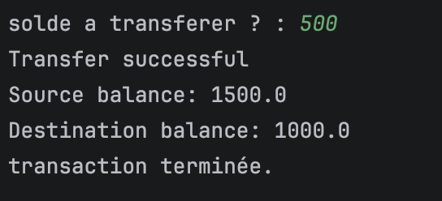
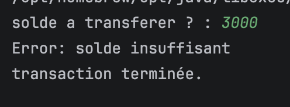
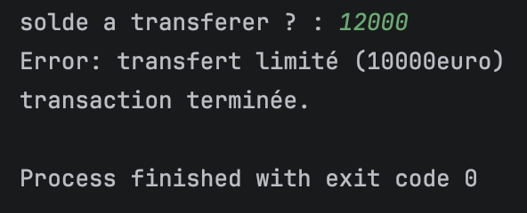
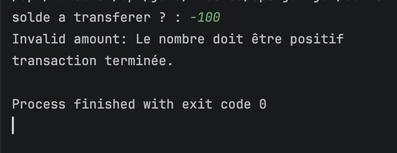
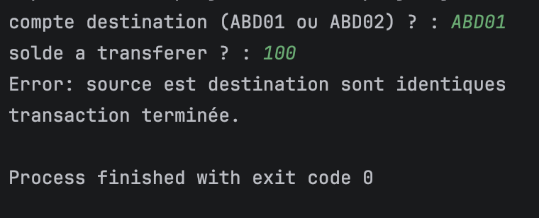
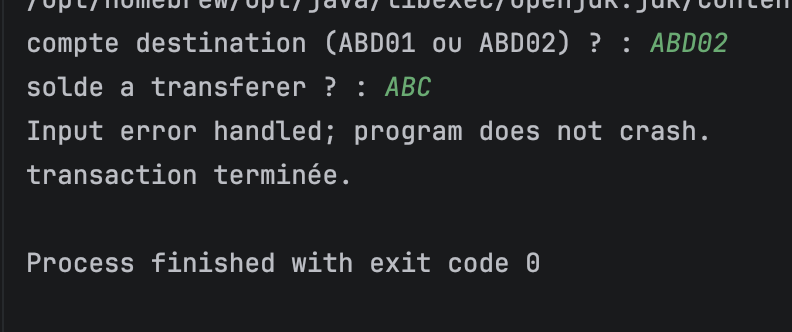
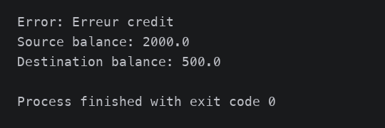

# TP2 - Secure Bank Transfer System

## Scénarios de tests & Captures d'écran

### 1. Transfert valide (Succès)
> Transfert de 500 € depuis un solde de 2000 € vers un compte crédité à 500 €. Débit et crédit effectués avec succès.



---

### 2. Solde insuffisant (`InsufficientFundsException`)
> Tentative de transfert de 3000 € avec un solde initial de 2000 €.



---

### 3. Dépassement de plafond (`TransferLimitExceededException`)
> Tentative de transfert de 12 000 € (plafond maximal autorisé fixé à 10 000 €).



---

### 4. Montant négatif ou nul (`IllegalArgumentException`)
> Tentative de transfert d'un montant invalide (-100 €).



---

### 5. Comptes source et destination identiques (`InvalidAccountException`)
> Tentative de transfert de 100 € en choisissant le même compte (`ABD01`) en source et destination.



---

### 6. Saisie utilisateur non numérique (`InputMismatchException`)
> L'utilisateur entre une chaîne ("ABC") au lieu d'un nombre : l'erreur est interceptée et gérée proprement sans interruption brutale du programme.



---

### 7. Échec après débit et avant crédit (Compensation & Rollback)
> Simulation d'une défaillance inattendue pendant l'opération `credit()` (via `TestCompensation.java`).
> Le mécanisme de compensation (`catch (RuntimeException e) { source.credit(amount); throw e; }`) rétablit automatiquement le solde source à 2000.0 € afin de préserver l'intégrité du compte.



---

##  Compilation et Exécution

```bash
# Compilation de toutes les classes
javac *.java

# Lancement du programme interactif principal
java Main

# Exécution du test de compensation (Scénario 7)
java TestCompensation
```
